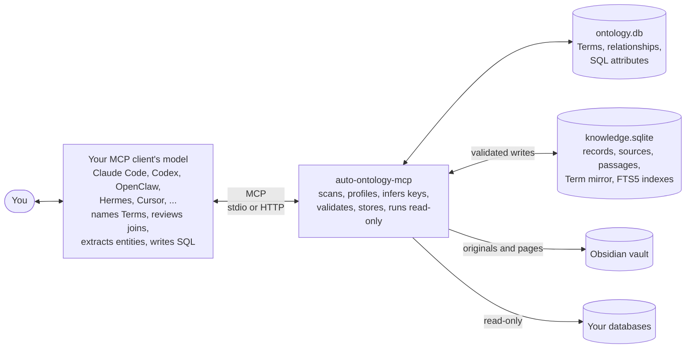
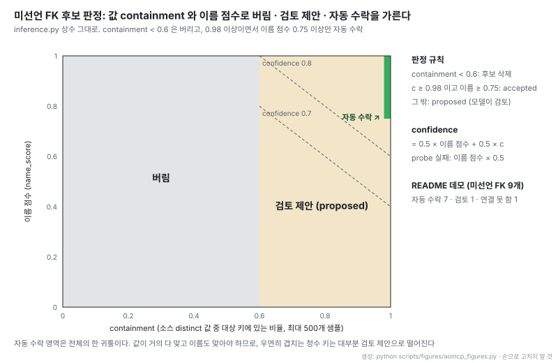
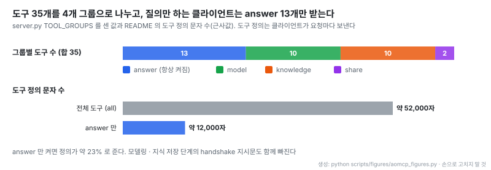

# auto-ontology-mcp: NVIDIA Auto Ontology의 시맨틱 레이어를 LLM 없이 MCP 서버로 옮기고 개인 지식 저장소를 더한 도구

출처: [auto-ontology-mcp README](https://github.com/gogoymh/auto-ontology-mcp/blob/b6e1f924f938be69fe272cad9104fa46ae6dbd16/README.md) (Apache-2.0)

- **원문**: [gogoymh/auto-ontology-mcp](https://github.com/gogoymh/auto-ontology-mcp) (설명: "NVIDIA Auto Ontology's semantic layer and a personal knowledge base as an MCP server for Claude, ChatGPT and other MCP clients. No LLM API key needed.")
- **원본 프로젝트**: [NVIDIA/auto-ontology](https://github.com/NVIDIA/auto-ontology) (Apache-2.0). [NOTICE](https://github.com/gogoymh/auto-ontology-mcp/blob/b6e1f924f938be69fe272cad9104fa46ae6dbd16/NOTICE)가 가져온 파일을 하나씩 밝히고, NVIDIA와 무관한 개인 프로젝트라고 적는다
- **저장소 생성**: 2026-11-06. 읽은 커밋 `b6e1f92` (2026-11-10), 커밋 11개, 버전 0.6.1
- **코드**: 라이선스 Apache-2.0, Python 3.12+, 의존성은 FastMCP · SQLAlchemy · sqlglot · PyYAML. 소스 25파일, 테스트 포함 11,785줄(가장 큰 파일은 도구 뒤 로직 2,131줄). 테스트 함수 111개. 별 308개 · 포크 44개 (2026-11-11 기준), 기여자 1명
- **검증 범위**: 이 노트는 README와 소스를 읽어 쓴 것이다. 테스트와 데모는 직접 돌리지 않았고, 데모 결과와 성능 수치는 README 값이다
- **읽은 날짜**: 2026-11-11
- **태그**: #Ontology #SemanticLayer #TextToSQL #MCP #KnowledgeBase #Provenance

!!! note "핵심 요약"
    NVIDIA Auto Ontology는 NIM LLM · 임베딩 · Postgres/pgvector 위에서 DB 메타데이터로 시맨틱 레이어를 만들고 Text-to-SQL을 돕는다. auto-ontology-mcp는 거기서 LLM · 임베딩 · 리랭킹 호출을 모두 걷어내고, 읽기 · 추출 · 이름 짓기 · 판정 · SQL 작성을 MCP 클라이언트의 모델에 넘긴다. 서버에는 스키마 추출, 프로파일링, 키 추론, 검증, 저장, read-only 실행만 남고 저장소는 로컬 SQLite다. 핵심 가치는 "조용히 틀리는 SQL"을 잡는 deterministic 검증이다. 온톨로지가 모르는 조인, 대소문자만 다른 literal, percent와 fraction 혼동, one-to-many fan-out으로 부푼 합계, 공통 부모에서만 만나는 경로를 실행 전에 경고한다. 여기에 원본에 없는 개인 지식 저장소를 더해, 영수증 · 문서 · 책 메모를 타입 있는 레코드 · 개념 · 발췌로 쌓고 모든 사실에 출처와 인용을 붙인다. 미선언 FK는 이름 휴리스틱과 값 containment로 판정하는데 자동 수락 조건이 containment 0.98 이상이면서 이름 점수 0.75 이상이라 꽤 보수적이다. 검색은 임베딩 없이 lexical이라는 것이 가장 큰 제약이다.

## 1. 개요

README는 문제를 한 문장으로 잡는다.

> "Text-to-SQL fails quietly. The query runs, a number comes back, and nothing says it is wrong."

모델이 raw 스키마만 보고 SQL을 쓰면 실행은 되는데 답이 틀린다. README의 "Why" 표가 그 유형을 여덟 가지로 든다. `billing_city_id`와 `delivery_city_id` 중 무엇이 "고객의 주"인지 추측하기, 정수가 우연히 겹친다는 이유로 `customers.customer_id = orders.order_id`로 조인하기, 저장값이 `'Pennsylvania'`인데 `'pennsylvania'`로 걸러 매출 0을 보고하기, 0에서 0.3 사이 값을 담은 컬럼에 `discount_pct > 20`을 쓰기, 주문 라인에 조인한 뒤 상품 가격을 합해 총액을 부풀리기, 한 상품의 주문 라인과 태그를 한 SELECT에서 같이 세기, 같은 부모만 공유하는 두 테이블을 연결된 것으로 보기, 커버되지 않는 지표(광고비 대비 매출)를 비슷한 컬럼으로 대신 답하기다.

auto-ontology-mcp는 이 문제를 NVIDIA Auto Ontology의 방식으로 풀되 구현을 뒤집는다. 원본은 자체 LLM(NIM)을 Next.js · FastAPI · Postgres 스택 뒤에서 돌린다. 이 프로젝트는 언어가 필요한 단계를 전부 사용자가 이미 쓰는 MCP 클라이언트의 모델에 맡기므로, 호스팅할 모델 엔드포인트도 API 키도 없다. 원문 표현으로 "The server keeps the deterministic work"다.

두 번째 용도는 개인 지식 저장소다. README는 이것을 [Karpathy의 LLM Wiki](https://gist.github.com/karpathy/442a6bf555914893e9891c11519de94f) 패턴의 대체재로 제시한다. LLM Wiki가 원천을 markdown 페이지로 컴파일한다면, 여기서는 같은 ingest · query · lint 루프를 온톨로지 위에서 돌린다. 사실은 합계를 낼 수 있는 타입 테이블로, 개념은 타입 있는 관계로 이어진 페이지로 가고, 모든 레코드 · 페이지 · 링크가 출처와 인용을 갖는다.

## 2. 원본과 갈리는 지점

README의 대응표를 단계별로 옮기면 다음과 같다.

| 단계 | NVIDIA Auto Ontology | auto-ontology-mcp |
| --- | --- | --- |
| 스키마 추출 · 프로파일링 | ingestion 서비스 | 서버 `scan_datasource` |
| 미선언 FK | LLM이 후보 컬럼 선택, 벡터 검색으로 대상 키, SQL probe로 값 확인 | 이름 규칙 + 같은 값 probe. 애매한 것은 모델에게 |
| Term과 컬럼 매핑 | LLM, 테이블 하나씩 | 클라이언트 모델이 같은 규칙으로 (`get_modeling_worklist`, `save_table_terms`) |
| SQL attribute 제안 | 웨어하우스 쿼리 이력에서 추출, LLM 판정 | 이 서버로 실행된 쿼리와 검증된 예시에서 추출, 모델 판정, 서버가 저장 전 실행 |
| 답 가능성 | LLM 엔티티 추출 + 임베딩 검색 | 모델이 엔티티 추출, 서버가 lexical 매칭 + 저장값 매칭 |
| SQL 작성 | LLM 에이전트 | 클라이언트 모델 |
| SQL 검사 | DB probe + LLM 리뷰 | 서버 `validate_sql`의 DB probe와 온톨로지 검사 |
| 저장 | Postgres + pgvector | 로컬 SQLite |
| 스키마 변경 | 예약된 재수집이 catalog diff, Term 없는 테이블만 모델링 | `scan_datasource`가 diff, 새 테이블과 컬럼이 늘어난 모델링된 테이블을 함께 반환 |

빠진 것도 README가 직접 적는다. 웹 UI와 REST API, 사용자 · 그룹 · RBAC, zone(접근 범위), PII 탐지, 임베딩 검색과 리랭킹, 차트, KumoRFM 예측, Apache Ossie 교환 형식이 없다. 대신 MCP를 통한 쓰기, 개인 지식 저장소, 타입 있는 관계를 가진 개념 페이지, 레코드 단위 provenance, FTS 발췌 검색, Obsidian 원본 보관과 export, 재스캔 시 새 컬럼을 모델에 돌려주는 기능이 더해졌다.

같은 원본을 다룬 노트 [NVIDIA Auto Ontology](%5B20260427%5D%20NVIDIA_auto-ontology_에이전트용_시맨틱레이어_TextToSQL.md)와 함께 보면, 원본의 "LLM이 하던 일"과 "코드가 하던 일"의 경계가 이 프로젝트에서 그대로 서버와 클라이언트의 경계가 됐다는 것이 보인다.

## 3. 구조

README의 "How it works" 흐름도를 그대로 옮긴다.

출처: [README "How it works"](https://github.com/gogoymh/auto-ontology-mcp/blob/b6e1f924f938be69fe272cad9104fa46ae6dbd16/README.md#how-it-works)

- 쓰기는 `knowledge.sqlite` 한 곳에만 일어난다. 연결한 데이터베이스는 항상 read-only다
- 온톨로지(`ontology.db`)와 지식 저장소(`knowledge.sqlite`)가 분리돼 있지만, 지식 저장소도 하나의 데이터소스(`knowledge`)로 등록돼 같은 검증과 질의 도구를 탄다
- 모듈은 역할별로 나뉜다. catalog · profiling · inference가 스캔, validation · sqlcheck가 검증, knowledge · textindex · vault · wiki가 지식 저장소, guidance가 원본 프롬프트에서 옮긴 규칙이다

## 4. 미선언 FK 추론

원본은 FK 후보 컬럼을 LLM이 고르고, 어느 키를 가리키는지는 벡터 검색으로 찾고, 실제 값이 맞는지를 SQL probe로 확인한다. 이 프로젝트의 추론 모듈은 앞의 두 단계를 이름 휴리스틱으로 바꾸고 세 번째 단계는 그대로 둔다. 모듈 주석의 표현은 "the first two steps are name heuristics and the third is kept as is"다.

이름 단계는 `customer_id → customers.id`, `delivery_city_id → cities.city_id` 같은 패턴을 맞추고, 테이블 이름과 difflib 유사도가 0.85 이상이면 이름 점수 0.6을 준다. `parent`, `manager`, `reportsto` 같은 단어는 자기 참조로, `amount`, `price`, `pct` 같은 단어는 측정값으로 보고 키 후보에서 뺀다. 값 단계는 소스 컬럼의 distinct 값을 최대 500개까지 뽑아 대상 컬럼에 몇 개가 있는지 센 비율(containment)을 잰다.

- 자동 수락은 오른쪽 위 작은 띠다. 값이 98% 이상 맞으면서 이름도 맞아야 한다. 정수 키가 우연히 겹치는 경우는 이름 점수가 낮아 검토 제안으로 떨어지고, 모델이 `list_relationships` · `set_relationship`으로 판정한다
- containment가 0.6 미만이면 이름이 완벽해도 후보 자체를 버린다. 이름보다 데이터를 믿는 설계다
- confidence는 이름 점수와 containment의 평균이다. probe가 실패하면 이름 점수의 절반만 남겨 제안으로 넘긴다

연결 테이블(bridge table)도 같은 모듈이 가른다. 키가 아닌 컬럼이 전부 FK면 확정이고, 수량 · 역할 · 순서 같은 payload 컬럼이 두 개 이하면 후보로 둔다. README 데모(테이블 11개)에서는 미선언 FK 9개 중 7개가 자동 수락, 1개(`employees.manager_id`, 자기 참조)가 검토 제안, 1개(`orders.sales_rep_id`, 이름이 맞는 테이블 없음)가 연결 못 함으로 나왔다고 보고한다.

## 5. 답 가능성 판정

`check_answerable`은 모델이 질문에서 뽑은 엔티티를 Term · 속성 · SQL attribute, 그리고 데이터에 저장된 이름(상품명, 지명, 상태값)과 맞춘다. 엔티티마다 상태가 붙는다.

| 상태 | 뜻 |
| --- | --- |
| `covered` | Term이나 속성이 직접 커버 |
| `covered_by_value` | 저장값과 일치. 필터 literal로 써야 한다 |
| `covered_via_glossary` | 용어집 정의가 모델의 일부를 가리킴 |
| `weak`, `unmodeled_table` | 약한 매칭, 또는 Term이 없는 테이블 |
| `not_covered` | 아무것도 없음 |

판정은 빠진 엔티티가 없으면 `answerable`, 전부 빠지면 `not_answerable`, 일부만 빠지면 `partially_answerable`, 약한 것만 있으면 `uncertain`이다. 일부만 빠졌을 때 서버가 돌려주는 지시문은 "Do not substitute a similar measure"로, 비슷한 지표로 대신 답하는 것을 막는 데 초점이 있다. README 데모의 광고비 대비 매출 질문이 `partially_answerable`, coverage 0.33으로 끝나고 모델이 "이 데이터베이스에는 광고비가 없다"고 답하는 예가 이 경로다.

엔티티가 다 커버돼도 끝이 아니다. 매칭된 테이블들이 행 대 행으로 이어지는지, 질문이 명시한 테이블에서만 만나는지, 질문에 없는 공통 부모에서만 만나는지, 아예 안 이어지는지를 다시 본다. 공통 부모에서만 만나거나 안 이어지면 `answerable`을 `uncertain`으로 내린다. 0.6.1에서 조인 경로도 짧은 경로보다 행끼리 묶이는 경로를 우선하도록 바뀌었다. 용어집은 구절을 해석할 뿐 커버로 세지 않는다는 규칙도 최근 커밋에서 들어왔다.

## 6. SQL 검증

`validate_sql`은 원본 Text-to-SQL 복구 경로(`db_probe`)의 deterministic 검사를 옮기고 몇 가지를 더했다. sqlglot으로 SQL을 파싱해 컬럼이 어느 물리 컬럼에서 왔는지 추적한 뒤 검사한다.

| 검사 | 내용 |
| --- | --- |
| 모르는 컬럼 | 온톨로지가 부르는 이름을 함께 제시 |
| 모르는 조인 | 온톨로지가 아는 조인을 제시. 조인 SQL attribute로 저장된 조인은 아는 것으로 취급 |
| near-miss literal | `WHERE` · `HAVING` · select 목록 비교(`SUM(status = 'shipped')`)의 literal이 저장값과 다르면 가까운 실제 값 제시 (유사도 기준 0.6) |
| list 컬럼 | `'SLE, RA'`처럼 목록을 담은 컬럼에 `=` 비교 경고 |
| percent vs fraction | 컬럼 범위가 0~1인데 20을 쓰면 0.2를 뜻했는지 묻고, 반대 방향도 묻는다 |
| fan-out | 집계 대상 기준. 주문 라인 위에서 `SUM(products.unit_price)`는 경고, `SUM(order_lines.quantity * products.unit_cost)`는 행마다 계산된 값이라 경고하지 않는다 |
| branch fan-out | 같은 테이블에서 one-to-many로 갈라진 두 가지(주문 라인과 상품 태그)를 함께 집계하면 경고. 다른 가지로 GROUP BY하면 예외 |
| dry run | 쿼리를 `LIMIT 0` 서브쿼리로 감싸 DB에서 한 번 실행해 오류만 확인 |

fan-out 판정을 "조인 모양"이 아니라 "무엇을 집계하는가"로 한 것이 실용적이다. 조인만 보고 경고하면 정상 쿼리에도 경고가 쏟아지고, 모델은 곧 경고를 무시하게 된다.

## 7. 안전 장치

서버가 쓰는 곳은 `knowledge.sqlite` 하나이고, 지식 도구가 검증된 입력으로 파라미터화된 문장을 만든다. `run_sql`은 그곳에도 쓰지 못한다. 연결 DB에는 세 겹의 read-only가 걸린다.

1. **SQL guard**: 호출당 `SELECT` · `WITH` · 집합 연산 하나만 허용한다. DML · DDL · `PRAGMA` · `ATTACH` · `SELECT … INTO` · `FOR UPDATE`와 파일 · 원격 서버 · 서버 상태에 닿는 함수(`pg_read_file`, `dblink`, `LOAD_FILE`, `set_config`, `load_extension` 등)를 거부한다. 읽을 수 있는 테이블을 스캔한 catalog로 allow-list해서 `sqlite_master`, DuckDB의 파일 경로 FROM, `OPENQUERY`도 막는다

2. **read-only 연결**: SQLite는 `mode=ro`, PostgreSQL은 `default_transaction_read_only`, DuckDB는 `read_only`, MySQL은 read-only 세션으로 연다

3. **rollback**: 모든 트랜잭션을 되돌린다

쿼리는 30초에 끊기고 최대 500행(기본 100행)만 돌려준다. HTTP로 띄우면 localhost 밖에서는 토큰이 필수이고, 토큰이 없으면 다른 Host로 온 요청을 DNS rebinding 방어로 거부한다.

!!! warning "데이터소스 URL은 평문 저장"
    README가 직접 경고한다. 비밀번호가 든 데이터소스 URL이 `ontology.db`에 평문으로 저장된다. 도구 출력에서는 가리지만, read-only 계정을 쓰고 공유 머신에서는 `AUTO_ONTOLOGY_ALLOW_DATASOURCE_TOOLS=0`으로 MCP에서 데이터소스 추가를 숨기라고 권한다.

## 8. 개인 지식 저장소

원본은 데이터베이스를 수집하지 문서를 수집하지 않는다. 이 프로젝트는 같은 시맨틱 레이어 부품으로 문서용 저장소를 만들었다.

| 부품 | 담는 것 | README 예 |
| --- | --- | --- |
| Entity | 세고 합하고 비교할 사실. 타입 컬럼과 다른 엔티티 참조를 가진 테이블 | `Receipt`: paid_on, merchant → `Merchant`, category, total_krw |
| Concept | 의미. 한 줄 정의, markdown 본문, 타입 있는 관계(`is_a`, `part_of`, `related_to`, `causes` 등) | `Spaced Repetition` is_a `Learning Technique` |
| Passage | 다시 찾을 발췌나 절 요약. 원본의 heading과 관련 Term, 전문 검색 인덱스 | *Make It Stick* 2장 발췌 |
| Source | 각 레코드 · 개념 · 관계 · 발췌의 출처. locator, 인용, vault의 원본 경로 | `IMG_2041.jpg`, line 3 |

원본 전문은 Obsidian vault에 두고 저장소에는 요약 · 발췌 · 레코드 · 개념만 둔다. 원본을 잇는 방법은 세 가지다. vault에 이미 있는 노트를 가리키거나(`original`), 대화에만 있는 텍스트를 새 노트로 쓰거나(`original_text`, frontmatter에 텍스트의 sha256), PDF · 이미지를 복사한다(`original_file`). 발췌가 heading을 가지므로 검색 결과와 export 페이지가 `[[originals/Note#Heading]]`로 원본의 그 절을 연다.

쓰기 검증이 엄격하다. 배치 안에 날짜가 "last tuesday"로 적힌 레코드가 하나라도 있으면 배치 전체를 저장하지 않고 문제를 전부 나열한다. 다른 레코드가 참조하는 레코드는 지울 수 없고, 레코드가 있는 엔티티는 `force` 없이 지울 수 없고, 컬럼 타입은 바꿀 수 없다. 같은 영수증을 두 번 넣어도 키와 중복 감지 때문에 바뀌는 것이 없다.

Term · SQL attribute에는 draft · certified · deprecated 상태가 있고, certified 정의를 고치면 draft로 돌아간다. 검증된 질문과 SQL 쌍은 이후 답변의 예시로 쓰인다.

검색은 SQLite FTS5다. 텍스트 인덱스 모듈 주석이 토크나이저 선택 이유를 밝힌다. trigram은 세 글자 미만 단어를 못 찾아 기억 · 학습 같은 한국어 명사 대부분이 빠지므로, `unicode61`에 prefix 질의를 쓴다. prefix 질의는 조사가 붙은 단어(기억 → 기억을)도 찾는다. 질의 쪽에서는 한 글자 조사(을 · 를 · 이 · 가 …)와 두 글자 조사(에서 · 으로 · 까지 …)를 떼고, 합성어 안의 부분 문자열(망각곡선 안의 곡선)은 `LIKE`로 찾으라고 모델에게 안내한다.

개념 그래프도 SQL 테이블이다. `terms`, `term_relations`, `passages`, `passage_terms`와 FTS 인덱스가 레코드 옆에 있어서, 전문 검색 · `WITH RECURSIVE` 관계 순회 · 레코드 필터를 한 문장에 넣을 수 있고 `validate_sql`이 그 문장도 검사한다. 인덱스는 트리거로 행 단위 갱신된다. README는 passage 20,000개 저장소에서 레코드 추가 약 20 ms, passage 저장 약 40 ms(Apple M4 Pro, 다섯 번의 중앙값)라고 보고한다.

## 9. 원천이 바뀔 때

아무것도 다시 빌드하지 않는다. 변경은 해당 행만 건드린다.

| 바뀐 것 | 동작 |
| --- | --- |
| 문서 | 같은 `uri`로 소스를 다시 저장하고 `save_passages(replace=true)`. 텍스트가 같은 발췌는 id와 Term 링크를 유지, 나머지는 삭제 목록으로 반환. 새 원본은 `(2)`가 붙은 새 노트가 되고 옛 노트는 사용자 주석과 함께 남는다 |
| DB 스키마 | `scan_datasource`가 catalog를 diff. Term, certified 상태, 검토한 조인, SQL attribute는 유지하고 추론 조인은 다시 시험. 새 테이블과 컬럼이 늘어난 모델링된 테이블을 worklist로 돌려줌 |
| DB 행 | 아무것도 안 함. 질의는 라이브 DB에 간다 |

서버는 파일을 감시하지 않는다. 모델이 새 버전을 읽고 무엇이 바뀌었는지 저장소에 알려야 한다. 원본 Auto Ontology의 재수집이 "Term이 없는 테이블만" 모델링하는 것과 달리, 이미 모델링된 테이블에 컬럼이 늘면 그것도 모델에게 돌려보낸다는 점이 이 프로젝트가 더한 부분이다.

## 10. 도구 구성

- 도구 35개가 answer · model · knowledge · share 네 그룹으로 나뉜다. answer 그룹 13개는 항상 켜져 있고 나머지는 `AUTO_ONTOLOGY_TOOLSETS`로 고른다
- 이미 누군가 모델링한 DB에 질문만 하는 클라이언트는 answer만 켜면 된다. README는 도구 정의가 약 52,000자에서 약 12,000자로 준다고 적는다. 도구 정의는 클라이언트가 요청마다 보내므로 그만큼 컨텍스트가 빈다
- 읽기 도구는 `readOnlyHint`, 지울 수 있는 도구는 `destructiveHint`를 달아 클라이언트가 확인 절차를 고를 수 있게 했다

프롬프트는 `build_ontology`, `answer_question`, `remember`, `review_ontology` 네 개이고, 서버가 handshake 때 작업 순서(답 가능성 확인 → 조회 컨텍스트 → 검증 → 실행)를 지시문으로 보낸다. ChatGPT 커넥터가 기대하는 `search` · `fetch` 모양의 도구도 있다.

## 11. 데모

`auto-ontology-mcp demo`는 가상 매장 하나를 주제로 세 가지를 만든다. 합성 소매 DB(테이블 11개, 주문 3,200건), 지식 저장소에 넣은 매장 문서 세 개(회의록, 태그 가이드, 품질 다이제스트), 두 쪽을 다 써야 답할 수 있는 질문이다. README는 도구 출력이 테스트 고정 데이터를 실제로 돌린 결과를 줄인 것이고 모델의 답은 예시라고 밝힌다.

- **정형 데이터**: "2024년 6월 펜실베이니아에서 sushi roll flash drive 매출"에 첫 SQL 초안이 틀린 조인과 소문자 literal로 두 번 걸리고, 고친 쿼리가 매출 316.8, 주문 라인 4건을 낸다. 답에 쓰인 Term이 아직 draft라는 사실도 함께 전한다
- **비정형 데이터**: 태그 가이드에서 "bestseller는 홈페이지 배치 결정이지 판매 순위가 아니다"라는 발췌를 찾아 원본 절 링크와 함께 답한다. 회의록의 인과 관계(`causes`, `part_of`)를 `WITH RECURSIVE`로 거슬러 중서부 매출 하락 원인을 잇는다
- **함께 쓰기**: DB가 중서부 주문이 1월 32건 → 17건, 2월 30건 → 19건, 9월 34건 → 16건으로 줄었음을 보이고, 문서가 물류 이관과 9월 재고 부족을 이유로 댄다. bestseller 상품의 평균 판매량(1,309개)이 다른 상품(1,365개)보다 적다는 숫자가 태그 가이드의 정의와 맞아떨어진다

데모 DB를 새로 스캔하면 기본 city 역할이 `billing_city_id`가 된다는 대목도 README에 있다. 두 컬럼 이름이 모두 `city_id`가 아니면 원본의 fallback이 알파벳 순서상 첫 역할을 고르기 때문이다. `set_relationship(..., is_default=true)`로 바꾸고, `get_query_context`가 어느 쪽이든 다른 역할을 함께 알려 준다. 기본값이 의미가 아니라 알파벳 순서로 정해진다는 것은 모르고 쓰면 틀리기 쉬운 지점이다.

## 12. 해석 시 주의

- **검색이 lexical이다**: 임베딩이 없으므로 Term과 컬럼은 토큰 겹침 · trigram 유사도 · 구절 일치로, 문서는 FTS5 bm25로 찾는다. 사용자가 데이터와 다른 말로 물으면 놓친다. 서버 지시문은 모델에게 스키마 어휘로 검색하고, 다른 언어 구절은 번역하고, 사용자 표현을 동의어로 추가하라고 요구한다. 결국 품질이 클라이언트 모델의 성실함에 달렸다
- **판정 품질이 클라이언트 모델에 달렸다**: Term 이름 짓기, 조인 검토, 엔티티 추출을 모두 클라이언트 모델이 한다. 같은 서버라도 어떤 모델을 붙이느냐에 따라 온톨로지가 달라진다. 서버의 deterministic 검증은 모델이 쓴 SQL의 형태를 잡을 뿐 Term 정의의 의미가 맞는지는 보장하지 않는다
- **테스트 범위**: README는 SQLite와 PostgreSQL 17에서 테스트를 돌린다고 하고, MySQL과 DuckDB는 같은 코드 경로를 타지만 실제 서버에서 시험하지 않았다고 밝힌다
- **이른 단계**: 저장소가 생긴 지 닷새, 기여자 한 명, 커밋 11개다. 그 사이 0.4.0 → 0.6.1로 검증 규칙이 계속 바뀌었다(branch fan-out, select 목록 literal, 공통 부모 경로, 용어집 해석). 규칙이 아직 움직이는 중이다
- **단일 사용자**: 지식 저장소는 내 컴퓨터의 단일 사용자 저장소다. 원본에 있던 RBAC · zone · PII 탐지가 없어서 여럿이 쓰는 환경에 그대로 올릴 수는 없다
- **생성 페이지는 단방향**: Obsidian export 페이지를 고쳐도 저장소로 돌아오지 않는다. 고치려면 모델을 통해 저장소를 바꾸고 다시 export해야 한다

## 13. 관련 노트

- [NVIDIA Auto Ontology: DB 메타데이터로 만드는 에이전트용 시맨틱 레이어와 Text-to-SQL](%5B20260427%5D%20NVIDIA_auto-ontology_에이전트용_시맨틱레이어_TextToSQL.md): 원본. LLM이 하던 단계가 이 프로젝트에서 클라이언트 모델로 옮겨 갔다
- [auto-ontology-eval: 온톨로지가 Text-to-SQL 정확도를 얼마나 올리는지 재는 대조 평가 도구](%5B20260702%5D%20NVIDIA_auto-ontology-eval_TextToSQL_온톨로지효과_대조평가.md): 원본 쪽 평가 도구. 이 프로젝트에는 같은 대조 평가 결과가 아직 없다
- [iKnow: macOS 개인 지식 그래프 열람 도구](%5B20260915%5D%208rank_iKnow_macOS_개인지식그래프_열람도구.md): 개인 지식 그래프에서 복사한 사실과 추론한 사실이 섞이는 문제를 다룬다. 이 프로젝트는 반대로 모든 레코드에 source · locator · quote를 강제한다
- [Karpathy의 LLM Wiki gist](https://gist.github.com/karpathy/442a6bf555914893e9891c11519de94f): README가 대체 대상으로 드는 패턴

## 14. 결론

auto-ontology-mcp가 보여 주는 것은 "LLM이 들어간 시스템에서 LLM을 빼면 무엇이 남는가"다. NVIDIA Auto Ontology에서 LLM · 임베딩 · 리랭킹을 걷어내니 스키마 스캔, 값 probe 기반 키 추론, sqlglot 기반 검증, read-only 실행이라는 deterministic 코어가 남았고, 그것만으로도 Text-to-SQL이 조용히 틀리는 유형 대부분을 실행 전에 잡을 수 있다. 언어 작업은 사용자가 이미 쓰는 모델에 넘기니 운영할 모델이 없다.

설계에서 따라 할 만한 것은 세 가지다. FK를 이름보다 값으로 판정하고 자동 수락을 좁게 잡은 것, fan-out을 조인 모양이 아니라 집계 대상으로 판정해 경고를 줄인 것, 답 가능성을 엔티티 커버리지와 테이블 연결 두 단계로 나눠 "다 커버되지만 이어지지 않는" 질문을 `uncertain`으로 내린 것이다. 개인 지식 저장소는 LLM Wiki에 출처 · 타입 · 검증을 더한 형태로, 숫자를 다시 물어야 하는 기록(영수증, 지출, 측정값)에서는 markdown 페이지보다 다루기 쉽다. 반면 검색이 lexical이고 품질이 클라이언트 모델에 달려 있다는 점, 그리고 다중 사용자 통제가 빠진 점이 이 구조를 개인용에 머물게 한다.
